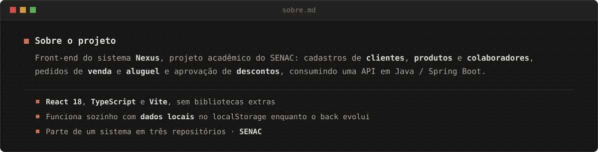



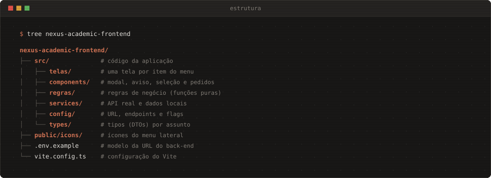


Este repositório guarda **apenas a parte do front**. O sistema completo é dividido em três repositórios:

| Repositório | O que contém | Link |
|---|---|---|
| **nexus-academic-frontend** (este) | Interface web (React + TypeScript) | https://github.com/GabrielCardossso/nexus-academic-frontend |
| Back-end do Nexus | API (Java / Spring Boot), mantida por ([@LionT750](https://github.com/LionT750)) | https://github.com/LionT750/Nexus |
| Repositório do tech lead | Junta front + back para integração e testes | _adicionar link_ |

> Este projeto tem fins exclusivamente educacionais.

### Equipe

- Front-end: Gabriel ([@GabrielCardossso](https://github.com/GabrielCardossso))
- Back-end: Lucas ([@LionT750](https://github.com/LionT750))
- Tech lead: Rafael ([@confeyte](https://github.com/confeyte))
- QA: João ([@CoruJa1m](https://github.com/CoruJa1m))


Pré-requisito: [Node.js](https://nodejs.org/) 18 ou superior.

```bash
# 1. Clonar o repositório
git clone https://github.com/GabrielCardossso/nexus-academic-frontend.git
cd nexus-academic-frontend

# 2. Instalar as dependências
npm install

# 3. Criar o arquivo de ambiente (veja "Configuração"; opcional no modo local)
cp .env.example .env

# 4. Rodar em modo de desenvolvimento
npm run dev
```

O front sobe em **http://localhost:5173**.

Outros comandos:

```bash
npm run build     # confere os tipos (tsc) e gera a versão de produção na pasta dist/
npm run preview   # serve localmente a versão gerada pelo build
```


O endereço do back-end fica no arquivo `.env`, que **não vai para o Git** (use o `.env.example` como modelo):

```env
VITE_PROXY_BACK=http://localhost:8080
```

No `npm run dev`, o front usa um **proxy**: chama `/api/v1/...` no próprio endereço e o Vite repassa para o `VITE_PROXY_BACK`. Sem o `.env`, o proxy aponta para `http://localhost:8080`. Abra o front em `http://localhost:5173` (a porta é fixa no `vite.config.ts`): o CORS do back só libera essa origem, e o navegador manda a origem também pelo proxy, então em outra porta cadastrar, editar e excluir dão erro 403.

Para chamar o back direto (sem o proxy, por exemplo no build), defina `VITE_API_URL=http://endereco-do-back`. O **CORS** do back libera só a origem `http://localhost:5173`; outro endereço do front (como o de produção) precisa ser incluído no `SecurityConf` do back. Essa configuração só vale com `USAR_DADOS_LOCAIS = false`.

> Nunca suba o `.env` para o repositório. Ele já está no `.gitignore`.

### Endpoints usados

Todos os endpoints do back (repo `LionT750/Nexus`, branch `main`, commit `e4bd699`) estão ligados. O prefixo é **`/api/v1`** (context-path no `application.yml`), e os caminhos ficam em `src/config/api.ts`. Swagger: `http://localhost:8080/api/v1/swagger-ui/index.html`.

| Ação | Método | Caminho |
|---|---|---|
| Cadastrar / listar clientes | `POST` / `GET` | `/clientes` |
| Editar cliente | `PUT` | `/clientes/{id}/editar` |
| Desativar / reativar cliente | `DELETE` / `PUT` | `/clientes/{id}` · `/clientes/{id}/reativar` |
| Cadastrar / listar produtos | `POST` / `GET` | `/produtos` |
| Editar produto | `PUT` | `/produtos/{id}/editar` |
| Repor estoque | `PUT` | `/produtos/adicionarEstoque` |
| Excluir produto | `DELETE` | `/produtos/{id}` |
| Cadastrar / listar colaboradores | `POST` / `GET` | `/colaboradores` |
| Editar colaborador | `PUT` | `/colaboradores/{id}/editar` |
| Desativar / reativar colaborador | `DELETE` / `PUT` | `/colaboradores/{id}` · `/colaboradores/{id}/reativar` |
| Criar / listar pedidos | `POST` / `GET` | `/pedidos` |
| Detalhe / excluir pedido | `GET` / `DELETE` | `/pedidos/{id}` |
| Editar pedido | `PUT` | `/pedidos/{id}/editar` |
| Aprovar / reprovar desconto | `PUT` | `/pedidos/{id}/desconto` |
| Finalizar (registrar pagamento) | `PUT` | `/pedidos/{id}/finalizar` |
| Devolver aluguel | `PUT` | `/pedidos/{id}/devolucao` |
| Pedidos vencidos (inadimplência) | `GET` | `/pedidos/vencidosEmAberto` |
| Solicitações de desconto pendentes | `GET` | `/pedidos/solicitacoesDescontoEmAberto` |
| Pedidos de um cliente | `GET` | `/pedidos/cliente?idCliente=` (ou `cnpjCliente=`, `emailCliente=`) |
| Itens alugados | `GET` | `/produtos/listarAlugados` |

`listarPedidosDoCliente` e `listarProdutosAlugados` estão prontas em `services/api`, mas nenhuma tela usa ainda.

O front usa alguns nomes próprios por dentro (`categoria`, `limiteCredito`, `nome` do colaborador), e os arquivos de `src/services/api/` convertem para os nomes do back ao enviar e receber. Pedido e desconto usam exatamente os nomes e os enums do back:

```json
// POST /api/v1/pedidos (o cliente vai pelo CNPJ; desconto em fração: 0.10 = 10%)
{
  "CNPJcliente": "88447294000145",
  "descontoSolicitado": 0.12,
  "modalidadePagamento": "A_PRAZO",
  "dataVencimento": "2026-12-20",
  "descricao": "Obra do centro",
  "itensPedido": [
    { "codigoIdProduto": 1, "quantidade": 2, "isAluguel": false },
    { "codigoIdProduto": 3, "quantidade": 1, "isAluguel": true, "dataVencimentoAluguel": "2026-12-05" }
  ]
}

// PUT /api/v1/pedidos/{id}/desconto
{ "idColaborador": 1, "statusAprovacaoDesconto": "APROVADO" }
```

Os erros do back vêm no formato `ProblemDetail` do Spring (`detail`, `errors` e, em enum inválido, `allowedValues`), e o front mostra essas mensagens no aviso.


Aplicação com **menu lateral** (que pode ser recolhido para mostrar só os ícones) e cinco telas.

Em **Clientes**, **Produtos**, **Pedidos** e **Colaboradores**, a lista ocupa a tela e carrega sozinha. Não há busca nem filtro: o back-end ainda não oferece isso. O botão **+ Novo** no topo abre o formulário num **popup**, que fecha com Esc, com o "×" ou clicando fora. Mensagens de sucesso e erro aparecem num aviso no canto da tela. As caixas de seleção são um componente próprio (`Selecao`), que funciona por teclado (setas, Enter, Esc e a letra inicial da opção).

| Grupo | Tela | O que faz |
|---|---|---|
| Cadastros | **Clientes** | Cadastra, **edita**, **desativa** e **reativa** cliente (nome ou razão social, CNPJ, telefone, e-mail, categoria **Normal** ou **VIP** e limite de crédito) e mostra a situação (**em dia** ou **inadimplente**). |
| Cadastros | **Produtos** | Cadastra, **edita** (nome, descrição e preços), **repõe estoque** e **exclui** produto. O status (**Disponível**, **Indisponível**, **Desativado**) só aparece: o back não recebe status, e produto novo entra como **Disponível**. |
| Vendas | **Pedidos** | Monta o pedido (cliente, produtos, pagamento **à vista** ou **a prazo**, desconto e descrição). **Cada item** pode ser **venda** ou **aluguel**; no aluguel, informa até quando. Mostra a prévia com subtotal, desconto e total calculados com as regras do back. Permite **finalizar** (registrar o pagamento), **editar** e **excluir** pedido pendente e **devolver** aluguel. |
| Gestão | **Colaboradores** | Cadastra, **edita**, **desativa** e **reativa** colaborador (nome, **CPF** e e-mail), com quantas solicitações de desconto cada um decidiu. |
| Gestão | **Descontos** | Escolhe quem está aprovando (**Aprovando como**) e mostra as solicitações em duas abas: **Pendentes**, com **Aprovar** e **Reprovar** e o total de cada caso, e **Decididas**. O menu mostra quantas estão pendentes. |

**Excluir é soft delete**, igual ao back: cliente, colaborador, produto e pedido excluídos **somem das listagens**, mas continuam no banco. O back tem **reativar** para cliente e colaborador, mas **não para produto**.

Os selos de status usam cores sólidas: verde para pago, em dia, disponível e aprovado; laranja para pendente e indisponível; vermelho para vencido, inadimplente e reprovado; roxo para VIP; cinza para os neutros.


As regras são **as do back** (`PedidoService`, `ClienteService`, `ProdutoService` e `ColaboradorService`), escritas em funções puras na pasta `src/regras/` e usadas pela prévia na tela e pelos dados locais. A pasta `services/dadosLocais/` reproduz o back passo a passo, com as mesmas validações, a mesma ordem e as mesmas mensagens de erro.

### Pedido

- **Itens:** cada item é **venda** (preço de venda × quantidade) ou **aluguel** (preço de aluguel × quantidade). O aluguel exige a **data de devolução** (`dataVencimentoAluguel`, futura), e o valor **não muda com o tempo**. O estoque baixa quando o pedido é criado.
- **Pagamento:** **à vista** ou **a prazo** (não existe PIX no back). A prazo exige **data de vencimento** futura e reserva o total no **limite de crédito** do cliente; se o total passar do limite, o pedido é recusado. **Exceção (só no front, ver "Travas que só o front tem"):** com desconto aguardando decisão, reserva o valor **com o desconto pedido** (limite 12.750, pedido de 13.750 pedindo 10% → reserva 12.375 e entra).
- **Um status só:** todo pedido nasce **Pendente** e vira **Pago** em **Finalizar** (vale para à vista e a prazo). Não existe "confirmar" separado do pagamento. O enum do back também tem **Rejeitado**, mas nenhuma regra usa.
- **Finalizar:** só pedido pendente e sem desconto aguardando decisão. No a prazo, o valor reservado (o total) volta para o limite do cliente.
- **Total:** o back **grava** o total (soma dos itens × (1 − desconto autorizado), 2 casas). Ele é recalculado quando o pedido é editado ou o desconto é decidido.
- **Editar:** só pedido **pendente**. O cliente não muda. Dá para mudar descrição, pagamento, desconto e itens. O back muda **só o que vem no corpo**, então o front manda os itens só quando eles mudaram: quando vão, são **recotados pelo preço atual** (o formulário mostra o total antes e depois). O estoque e o limite reservados pelo pedido antigo voltam antes de valer o novo.
- **A prazo → à vista:** o valor reservado volta para o limite, mas o back **mantém o vencimento** no pedido; se ele não for finalizado até lá, o cliente fica inadimplente. O formulário avisa.
- **Excluir:** só pedido **pendente**. O estoque volta e, no a prazo, o valor reservado volta ao limite. O pedido some da lista.
- **Devolver aluguel:** devolve **todos os itens de aluguel ainda não devolvidos**, em qualquer status do pedido. O estoque volta e cada item ganha a data de devolução. O crédito não volta.

### Descontos

O desconto é **escolhido numa lista**, sem digitar: **5%, 10% ou 15%** (o cliente **Normal** não tem 15%). O botão **Limpar**, dentro da lista, volta para "sem desconto". Vai ao back como fração (0.10 = 10%). Regra nova de 2026-11-25: os dados locais só aceitam 0, 0.05, 0.10 ou 0.15, e o Lucas vai levar a mesma regra ao back.

| Cliente | Pedindo | Resultado |
|---|---|---|
| **Normal** | 0% | Sem desconto |
| **Normal** | 5% ou 10% | **Aguarda** um colaborador. |
| **VIP** | 0% ou 5% | **5% aprovados na hora** (automático) |
| **VIP** | 10% ou 15% | **Aguarda** um colaborador, e o pedido fica **sem desconto** até a decisão. Se reprovado, volta a **5%**. |
| **Inadimplente** | qualquer valor | O pedido é registrado como **reprovado por inadimplência**, sem desconto. |

- Decidido: aprovado vale o percentual solicitado; reprovado volta a 5% no VIP e fica sem desconto no Normal. No a prazo, o limite passa a segurar o total decidido no lugar do que estava reservado. Se o pedido só coube no limite por causa do desconto, **reprovar deixa o limite negativo**: o formulário e a tela de Descontos avisam antes.
- Na edição, pedir **mais** do que o autorizado volta a **aguardar** decisão. Pedir **igual ou menos** mantém o desconto já decidido (por exemplo, aprovado 15% e agora pedindo 10%: continuam os 15%). É intencional, confirmado pelo Lucas: o cliente não se prejudica pedindo um desconto pior. O formulário avisa quando o desconto pedido é menor que o autorizado e quando um desconto aprovado vai continuar valendo depois de mudar os produtos.

### Cliente inadimplente

- **Inadimplente** é quem tem pelo menos um pedido **pendente com vencimento antes de hoje**, em qualquer modalidade. Não é um campo do cadastro. Ao finalizar os pedidos vencidos, ele volta a ficar em dia.
- Não pode criar pedido a prazo nem trocar um pedido para a prazo. Um pedido que já era a prazo continua a prazo.
- O pedido novo dele fica **sem desconto** (reprovado por inadimplência).
- Cliente com pedido pendente **não pode ser desativado**.

### Travas que só o front tem

Estas regras **não existem no back** hoje. O front mantém porque, sem elas, o cliente sai da inadimplência sem pagar ou recebe desconto indevido. Elas estão com o Lucas para decidir se viram regra no back ou se saem do front:

- Pedido **vencido** não pode ser **editado** nem **excluído** (no back, mudar o vencimento ou apagar o pedido tira o cliente da inadimplência).
- O **vencimento** não muda na edição quando o pedido já tem um (inclusive depois de ir para à vista e voltar para a prazo).
- Pedido com **aluguel já devolvido** não muda os produtos (o back recriaria o item como não devolvido e baixaria o estoque de novo).
- Inadimplente editando um pedido a prazo **não pode aumentar o total**.
- Solicitação de desconto de cliente que **ficou inadimplente** depois de pedir só pode ser **reprovada**.
- Produto **Indisponível** ou **Desativado** não entra em pedido (o back só confere se existe e se tem estoque).
- No cadastro de colaborador, o **CPF** não pode repetir (o back só confere na edição).
- Pedido a prazo com desconto **aguardando decisão** reserva no limite o valor **com o desconto pedido** (pedido do Rafael, 2026-11-25). Liga e desliga em `RESERVA_COM_DESCONTO_PENDENTE` (`src/config/api.ts`): hoje só vale nos dados locais; com o back real, o front volta a reservar o total, como o back.
- Desconto só **0, 5, 10 ou 15%**, e o cliente **Normal** não pode pedir 15% (2026-11-25; o Lucas vai levar ao back).

Na edição de cliente, o limite de crédito só vai para o back se for alterado (o back mantém o que não vem no corpo).


Em `src/config/api.ts`, a constante `USAR_DADOS_LOCAIS` está como `true`: tudo é salvo e lido do **localStorage** pela pasta `src/services/dadosLocais/`, que faz o papel do back-end com as mesmas regras e mensagens. A diferença é que ela lista também os cadastros desativados, para poder reativar (o back não lista).

- Os dados ficam nas chaves `nexus:v10:clientes`, `nexus:v10:produtos`, `nexus:v10:pedidos` e `nexus:v10:colaboradores`. Para recomeçar do zero, abra **F12 > Application > Local Storage**, apague as chaves `nexus:*` e recarregue a página.
- **Dados de exemplo** (`CARREGAR_MOCKS = true`): os **mesmos** 6 clientes, 10 produtos e 4 colaboradores dos mocks do back, mais 11 pedidos que cobrem os cenários da tela: VIP com 5% automático, um pedido a prazo da **Reformas Silva** que só cabe no limite com o desconto pedido (caso do Rafael), VIP e Normal aguardando decisão, desconto aprovado e reprovado, aluguel para devolver e já devolvido, pedido pago e o **Mercado Bom Preco** inadimplente por um pedido a prazo vencido. Estoque e limite de crédito já vêm coerentes com esses pedidos.

Para usar o back-end real, troque para `USAR_DADOS_LOCAIS = false`.


Para rodar com o back real:

1. Suba o back (porta 8080) e confira o Swagger em `http://localhost:8080/api/v1/swagger-ui/index.html`.
2. **`USAR_DADOS_LOCAIS = false`** em `src/config/api.ts`.
3. `npm run dev`: o proxy do Vite leva `/api/v1` até o back (veja "Configuração").
4. **Conversão de campos** em `src/services/api/` (um arquivo por entidade, com os tipos `*Back*` iguais aos records Java), se o back mudar algum nome.
5. **Autenticação:** hoje o back libera tudo (`permitAll`). Se passar a exigir token, ajuste `getAuthHeaders()` em `src/services/api/http.ts`.

### Ainda falta no back

O back devolve tudo o que as telas precisam (ids, CNPJ, status do produto, itens e descontos do pedido) e libera CORS para `http://localhost:5173`. Ainda faltam:

- Listagem dos **desativados** (para reativar pela tela com o back real) e rota de **reativar produto**.
- As regras de **editar e excluir pedido** (pedido vencido, vencimento, aluguel já devolvido) e a troca **a prazo → à vista**, que hoje mantém o vencimento antigo: o Lucas confirmou que vai ajustar. Até lá valem as travas do front (seção "Regras de negócio").
- Status **cancelado** para pedido lançado errado (o Lucas pretende criar; hoje a saída seria excluir).
- A reserva do limite com o **desconto pendente** e os descontos só de **0, 5, 10 ou 15%** (Normal até 10%). Em aberto com o Rafael: o que fazer quando o desconto que fez o pedido caber no limite é **reprovado** (hoje o limite fica negativo).

**Celular (até 760px):** o menu vira uma barra de vidro embaixo (com uma lente que desliza até a aba ativa), e a logo e o "+ Novo ..." viram círculos de vidro no topo (tocar na logo volta ao topo). **A página não rola, só o `<main>`**: assim as barras do navegador do celular não encolhem nem cobrem esses elementos. É de propósito, não é bug. O `viewport-fit=cover` no `index.html` faz a página respeitar a área segura do iPhone.


As pastas `types`, `regras`, `utils`, `services/api` e `services/dadosLocais` têm um `index.ts` que reexporta tudo, então os imports ficam curtos (`from '../regras'`, `from '../services/api'`), e o comentário no topo do `index.ts` diz o que tem em cada arquivo. Componentes e telas são importados pelo caminho do arquivo (`from '../components/comum/Modal'`).

```
public/
└── icons/                    # ícones SVG do menu lateral
vite.config.ts                # porta 5173 e o proxy /api/v1 para o back
src/
├── main.tsx                  # ponto de entrada da aplicação
├── App.tsx                   # layout: menu lateral + troca de telas
├── estilos/
│   └── App.css               # estilos
├── config/
│   └── api.ts                # URL base, caminhos dos endpoints e flags USAR_DADOS_LOCAIS e CARREGAR_MOCKS
├── types/                    # tipos (DTOs), um arquivo por assunto
│   ├── cliente.ts
│   ├── produto.ts
│   ├── colaborador.ts
│   └── pedido.ts             # pedido, itens (venda ou aluguel) e enums do back
├── regras/                   # regras de negócio (funções puras), usadas pela tela e pelos dados locais
│   ├── pedido.ts             # valor dos itens, total e o que o pedido pode fazer (finalizar, editar, excluir, devolver)
│   ├── descontos.ts          # desconto na criação, na edição e na decisão (iguais ao back)
│   ├── inadimplencia.ts      # pedido vencido e cliente inadimplente
│   ├── datas.ts              # datas AAAA-MM-DD e o @Future
│   ├── mensagens.ts          # mensagens de regra, inclusive as travas que só o front tem
│   └── rotulos.ts            # textos e cores de cada valor dos enums
├── utils/                    # utilitários sem regra de negócio
│   ├── formatacao.ts         # moeda, datas, CPF e arredondamento
│   └── formulario.ts         # helper de formulário e tipo do aviso
├── services/
│   ├── api/                  # o que as telas chamam: back real ou dados locais
│   │   ├── http.ts           # GET/POST/PUT/DELETE e leitura do erro do Spring
│   │   ├── clientes.ts       # (cada arquivo traz os DTOs do back daquela entidade)
│   │   ├── produtos.ts
│   │   ├── colaboradores.ts
│   │   └── pedidos.ts        # pedidos, descontos, finalizar, devolver e excluir
│   └── dadosLocais/          # back-end "de mentira" no localStorage, com as regras do back
│       ├── armazenamento.ts  # chaves nexus:v10:*, formato das tabelas e ajudantes comuns
│       ├── validacao.ts      # CNPJ e CPF
│       ├── clientes.ts
│       ├── produtos.ts
│       ├── colaboradores.ts
│       ├── pedidos.ts        # criar, editar, excluir, finalizar e devolver (PedidoService)
│       ├── descontos.ts      # aprovar ou reprovar desconto
│       └── mocks.ts          # dados de exemplo (cadastros iguais aos mocks do back)
├── components/
│   ├── comum/                # peças reaproveitadas em várias telas
│   │   ├── Modal.tsx         # popup genérico (formulários)
│   │   ├── ConfirmarModal.tsx # popup de confirmação (desativar, excluir, finalizar, devolver)
│   │   ├── Aviso.tsx         # aviso flutuante de sucesso/erro
│   │   └── Selecao.tsx       # caixa de seleção própria (substitui o <select> nativo)
│   └── pedidos/
│       ├── PedidoForm.tsx    # formulário de pedido (novo e edição) com o seletor de produtos
│       └── PedidoCard.tsx    # card do pedido (resumo, ações e detalhes)
└── telas/                    # uma tela por item do menu
    ├── ClientesTela.tsx
    ├── ProdutosTela.tsx
    ├── PedidosTela.tsx
    ├── ColaboradoresTela.tsx
    └── DescontosTela.tsx
```


- [x] Caminhos `/api/v1` e nomes de campos do back (clientes, produtos e colaboradores)
- [x] Regras do front iguais às do back (pedido, desconto, inadimplência, soft delete) e todas as rotas ligadas
- [x] Proxy do Vite para o `npm run dev`
- [x] Back: `id` nas listagens, `cnpj` do cliente, `statusProduto`, itens e descontos do pedido, CORS
- [ ] Back: listar desativados e reativar produto
- [ ] Back: regras de editar e excluir pedido (o Lucas vai ajustar; depois, rever as travas do front)
- [ ] Decidir com o Lucas as travas que só o front tem (ver "Regras de negócio")
- [ ] Back: reserva com desconto pendente e descontos só de 0, 5, 10 ou 15% (depois, `RESERVA_COM_DESCONTO_PENDENTE = true`)
- [ ] Validação de formulário campo a campo
- [ ] Autenticação (se exigida pelo back)

<a href="https://github.com/GabrielCardossso"></a>
